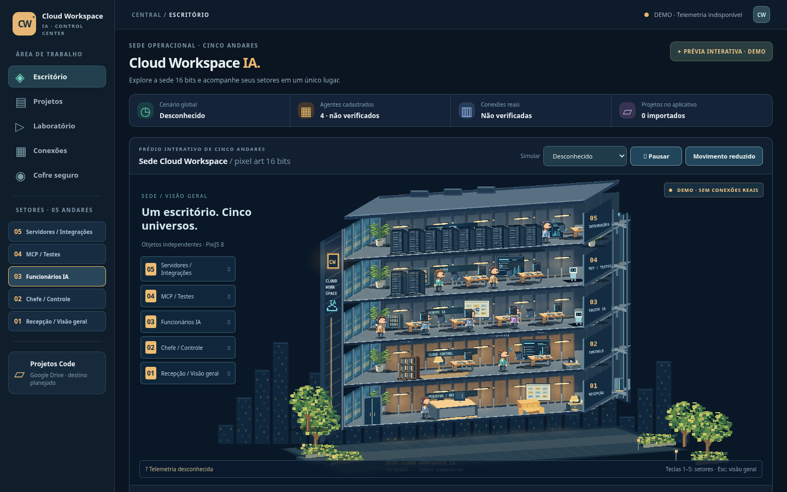

# Relatório visual Codex — PR #1, rodada premium 2

Data: 16/11/2026. Branch: `agent/codex/visual-5-floors`.
Continuação da entrega `616f406` no mesmo [PR #1](https://github.com/Raphahel30/cloud-workspace-ia/pull/1), sem merge ou deploy.

**Resultado:** escritório significativamente mais detalhado e próximo da composição aprovada, funcional no Chromium, com 215 sprites originais, trajetos/posturas e otimização seletiva. Foram preservados os 30 testes anteriores e acrescentados oito: **38 aprovados**. Aprovação artística final e desempenho nativo Windows continuam pendentes; não declaramos reprodução idêntica do conceito.

## Implementação visual

Mantida a aplicação existente React 19 / TypeScript / Vite / Tauri 2 com PixiJS 8. Nenhum reinício de produto, biblioteca gráfica nova ou integração real. Cinco setores aparecem simultaneamente, selecionáveis pelo prédio, controles React e teclado; zoom suave, Escape, foco visível e movimento reduzido preservados.

- **Personagens:** rosto/cabelo em camadas, headset, roupas com lapela/dobras, pele preservada nas paletas, pernas/calçados, piscada discreta e poses sentadas. Quatro quadros de caminhada lateral e posterior, quatro de digitação e dois de sentar/levantar e dos demais estados visuais. Pés ancorados independentemente da pose.
- **Móveis:** mesa de madeira, gavetas/pés, cadeira, teclado, monitor, recepção, café, armários e painéis mais detalhados. Teclado/monitor são sprites independentes. Tela estreita olha para o personagem; verso com ventilação olha para o observador. Mãos/teclado e oclusão da cadeira foram ajustados nas capturas ampliadas.
- **Arquitetura:** largura útil aumentada, projeção consistente, materiais de parede, rodapés, juntas metálicas, painéis, letreiros, detalhes de telhado e fachada. Sem deformar a proporção dos sprites para alargar o prédio.
- **Vegetação/ambiente:** árvores, folhagens variadas e cercas vivas em lugar de repetir somente vasos. Cidade noturna e iluminação âmbar/ciano preservadas. Refletância e luzes são rasterizadas previamente no atlas; sem filtros dinâmicos pesados.

Fontes editáveis em `assets/source/`; desenho em `scripts/art/premium.mjs`; exportador em `scripts/generate-assets.mjs`. Atlas único `public/art/office.{png,json}`. [Documentação da arte](../../assets/README.md).

## Movimentos e estados

`src/scene/motion.ts` é uma máquina visual separada do núcleo: corredor frontal livre, aproximação à cadeira, sentar, digitar, levantar, percorrer corredor e desaparecer na saída. Velocidade limitada a 85 unidades de cena/s; avanço dos quadros de caminhada acompanha a distância. O pés permanecem dentro do piso (`y = -6 - 0,068x` no corredor), sem flutuar junto com o corpo. Espera/alerta/desconhecido interrompem deslocamentos preservando posição; retorno após ausência restaura presença também em estados diferentes de trabalho, inclusive com movimento reduzido.

Elevador ambiental agora acelera/freia, para alinhado às plataformas e abre/fecha portas durante a parada. Altura da cabine/plataformas foi conferida junto com a ampliação do prédio. Não representa tarefas reais ou usuários transportados.

A rota é deliberadamente simples e validada para o mobiliário fixo desta cena. Não é um sistema geral de navegação entre obstáculos ou circulação simultânea com resolução de colisão entre personagens. Paradas/poses foram testadas; não alegamos um simulador físico completo.

Estado inicial desconhecido; indicador DEMO permanente. Simulação individual e global não altera evidências reais. Chefe continua aparecendo somente no cenário explicitamente DEMO de trabalho. LEDs desconhecidos ficam cinza. `ActorStates` e adaptador puro de evidências continuam separados do relógio visual. Não criamos processos/conectores MCP, Windows, GitHub de produto, Drive, KeePassXC ou Hostinger.

## Otimização para o hardware informado

Referência de projeto: Ryzen 5 5600G, Radeon integrada, 16 GB RAM, SSD NVMe 512 GB. Não pedimos testes preliminares no computador para decidir arquitetura.

- Meta configurada: **30 FPS em atividade, até 10 em repouso, suspensão de renderização invisível**. Caminhada/sentar/saída usam orçamento ativo enquanto ocorrem, mesmo antes de chegar ao estado de repouso/ausência.
- Atlas compartilhado com recorte transparente preservando a origem: 106→215 sprites; pixels do atlas **1024×1792→1024×964**, aproximadamente **7→3,77 MiB RGBA**. Cerca de 46% menos pixels de atlas, sem remover detalhes. Isso não é uma medição de VRAM total.
- Oito caches densos: cidade/piso externo, cinco estruturas interiores, telhado e fachada oeste. Atores, equipamentos, LEDs, seleção e elevador continuam independentes. Caches parciais preservam oclusão e interação; não são imagem única do prédio.
- Fachadas finas e vegetação esparsa ficam em geometria/sprites compartilhados: cachear seus grandes retângulos transparentes é desperdício. Comparativo curto com 14 caches está registrado; os oito selecionados evitam seis render textures adicionais.
- LEDs recalculam seus desenhos somente quando muda estado/fase luminosa, em vez de reconstruir geometria a cada frame. Sem filtros de desfoque em runtime, sem DPR multiplicando a resolução, nearest-neighbor e orçamento que desconta custo de desenho.
- Pausa/reduced-motion interrompem animação; cena invisível interrompe timers/desenho; retorno/resize pode emitir um frame necessário. Desmontagem libera aplicação/contexto, listeners, observers e timers; atlas em cache é reutilizado. Relógio visual não executa serviços do núcleo.

## Validação executada

Linux, Node 24.22.1, npm 11.9.0, Chromium headless dedicado com ANGLE/SwiftShader (software). Dependências/lockfile da rodada anterior preservados; nenhuma dependência nova foi instalada.

| Verificação | Resultado final |
| --- | --- |
| `npm run build` | PASSOU, TypeScript + Vite, 791 módulos |
| `npm test` | PASSOU, 22 testes Vitest em cinco arquivos |
| `npm run test:policy` | PASSOU, 3 testes Node originais |
| `npm run test:contracts` | PASSOU, 5 testes Node protegidos |
| `npm run test:e2e` | PASSOU, 8 testes, 0 falhas/0 flaky, cerca de 70,8 s |
| `npm run art:build` + SHA-256 das fontes/atlas antes/depois | PASSOU, reprodução byte a byte |
| `npm run benchmark:visual` | EXECUTADO, amostras reais abaixo |
| `git diff --check` e diff dos arquivos protegidos/Tauri | PASSOU, contratos e configuração Tauri intactos |
| Windows/Tauri/instalador/consumo no Ryzen | NÃO EXECUTADO |

Preservados os 30 testes anteriores. Acrescentados seis testes de movimento/elevador, um de packing/origem/limites da textura e um teste de navegador para pés fixos, sentar/levantar, espera/saída, orçamento de atividade e reentrada reduzida. O teste antigo de saída mantém sua asserção, com timeout maior para o trajeto completo mais longo. Nenhum teste protegido foi editado.

Playwright cobre 1280×800 e 1440×900, cinco setores completos no viewport, zoom/retorno, clique na geometria, Enter/1–5/Escape, foco, estados globais/individuais, pausa, reduced-motion do sistema, invisibilidade, congelamento/restauração Chromium, resize, desmontagem/remontagem e erro acessível de import gráfico.

Falhas desta rodada: quadros de repouso idênticos detectados no raster; pés escondidos pela laje por corredor fora da área do piso; mãos/teclado e planta sobreposta ao primeiro posto vistos na captura; personagem não reaparecendo após ausência em estados não ativos, detectado por revisão independente. Corrigidos e cobertos antes da execução final. A revisão posterior não encontrou novos P1/P2; não é auditoria geral do produto.

## Capturas e comparação

**Capturas atuais da aplicação executando**, sem composição sobre o PNG aprovado:

- [Visão geral 1280×800](screenshots/overview-1280x800.png) e [1440×900](screenshots/overview-1440x900.png).
- [Setor IA / desconhecido 1280×800](screenshots/agents-zoom-1280x800.png) e [1440×900](screenshots/agents-zoom-1440x900.png).
- [Setor IA trabalhando DEMO 1280×800](screenshots/premium-working-zoom-1280x800.png) e [1440×900](screenshots/premium-working-zoom-1440x900.png).
- [Trabalho DEMO / visão geral](screenshots/demo-working-1440x900.png) e [estados individuais DEMO](screenshots/demo-independent-1440x900.png).

A [comparação HTML](COMPARACAO_VISUAL.html) mostra referência artística, capturas anteriores arquivadas do commit `616f406` e capturas atuais. `baseline-*` são imagens reais antigas, claramente separadas das oito capturas atuais. A referência nunca entra no renderer.

Comparação observada: prédio mais largo, vegetação variada, contraste dos materiais, luzes/reflexos e densidade dos interiores mais próximos do conceito; rostos, roupas, mesas e cadeiras têm desenho mais definido. Ainda faltam o sombreamento artesanal orgânico e a expressividade/densidade ilustrativa da referência. Os letreiros internos são pequenos na visão geral; controles React e zoom preservam leitura no notebook. Aprovação artística final cabe à revisão humana.

## Desempenho medido — Cloud, não Windows

Benchmark reproduzível: iniciar `npm run dev`, executar `npm run benchmark:visual`. Mede frames efetivos após acomodação, 5 s de atividade e 3 s de repouso, CDP TaskDuration e heap JS. Chromium usa software, não a Radeon integrada.

| Amostra isolada final, oito caches | Resultado |
| --- | --- |
| Atividade | 118 frames / 5006 ms = **23,57 FPS** |
| Repouso | 30 frames / 3012 ms = **9,96 FPS** |
| Soma de tarefas da thread principal na atividade | 0,307583 s durante a janela de 5,006 s |
| Soma de tarefas da thread principal no repouso | 0,044041 s durante a janela de 3,012 s |
| Heap JS | 22.125.172 bytes em atividade; 25.795.432 bytes no repouso |

No teste E2E completo: 23,03 FPS em atividade e 9,90 FPS em repouso; heap JS de 37.573.512 bytes na amostra. A diferença entre contextos evidencia a natureza amostral dessas medidas. Pausa, reduced-motion e invisibilidade mantiveram frames/tempo constantes após acomodação quando aplicável.

No comparativo de cache, uma amostra com 14 caches deu 24,75 FPS em atividade / TaskDuration 0,248472 s; com oito, 23,92 FPS / 0,167406 s. Não há evidência estatística de ganho de FPS; escolhemos oito por menor quantidade de render textures e menor tempo de tarefas nessa amostra, com a mesma arte. A repetição final variou para os valores da tabela. Todos os dados estão em [METRICAS_VISUAIS.json](METRICAS_VISUAIS.json), [benchmark-isolado.json](benchmark-isolado.json) e [e2e-results.json](e2e-results.json).

**O alvo de 30 FPS não foi atingido neste Chromium por software.** TaskDuration não é CPU total; heap JS não é RAM total; tamanho RGBA do atlas não mede VRAM da aplicação. Não medimos CPU/GPU/energia totais nem consumo simultâneo com duas IAs/build no hardware alvo. Não declaramos desempenho garantido no Windows.

## Pendências e entrega

1. Revisão artística humana da aproximação ao conceito, especialmente sombra, expressividade, detalhes de fachada e decoração.
2. Rotas atuais são adequadas ao layout fixo; circulação com desvio entre personagens e móveis rearranjáveis exige módulo visual adicional.
3. Validar WebView2/Tauri, minimizar/restaurar, instalador e orçamento real de CPU/GPU/RAM/energia no Windows/Ryzen em etapa própria. O build web não comprova esses resultados.
4. Integrações reais permanecem exclusivas de outro fluxo. Nenhuma credencial, serviço externo ou projeto alheio foi alterado.

Novos commits desta rodada estão na mesma branch e no mesmo PR #1, para revisão. Sem merge ou deploy. Histórico completo: `git log --oneline origin/main..HEAD`.
